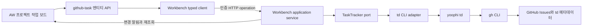

# AW GitHub Task Kanban 통합 계획

- 작성일: 2026-10-13.
- AW 기준 커밋: `760415c497f41081cba73a011981f2159c118de0`.
- td 기준 커밋: `c64d7873d8f555dd49875e34e6b39ae5257e2e0c` (`yoophi/td` main).
- 상태: 소스 조사에 기반한 구현 제안. 기능 구현·GitHub 이슈 생성·기존 이슈 변경은 수행하지 않았다.
- 상세 조사: [td 기능과 제약](td-github-capabilities-research.md).

## 1. 권장 방향

AW 프로젝트 상세 화면에 **GitHub 작업 보드**를 제공한다. GitHub Issues와 td 메타데이터를 작업 정보의 정본으로 삼고, td의 보드·워크플로를 AW UI에서 사용한다. 기본 열은 `대기 / 진행 중 / 차단 / 검토 중 / 완료`다.

AW는 카드 렌더링, 선택, 검색, 작업대 연결을 담당한다. 작업 상태·리뷰 규칙·보드 순서·필터 저장은 td에 위임한다. GitHub API로 td 메타데이터를 직접 고치거나 AW가 별도 작업 DB를 만들지 않는다.

초기 범위는 **GitHub Issues 기반 td 보드**다. GitHub Projects v2의 필드·보드 동기화는 별도 기능이며 초기 범위에 포함하지 않는다. GitHub Issue assignee와 td implementer session도 서로 다른 정보로 취급한다.

## 2. 확인한 기능과 현재 AW의 차이

| 확인 대상 | 실제 기능 | AW에서의 활용 |
|---|---|---|
| td GitHub 저장소 | `gh-issue` store, `gh` 인증, Issue 및 td 메타데이터 저장 | 프로젝트 저장소에 연결된 작업 정본 |
| td 보드 | 기본 All Issues, 사용자 보드 CRUD, TDQ query, 순서 이동·해제 | 보드 선택기, 저장된 필터, 카드 정렬 |
| td 워크플로 | `open`, `in_progress`, `blocked`, `in_review`, `closed` 및 전용 명령 | 열과 상태 이동 액션 |
| td 상세 정보 | 로그, structured handoff, 리뷰 이력, 부모·의존성·파일 연결 | 카드 상세 패널, 검토·인계 표시 |
| td 세션 | device/worktree/branch/agent/context 범위 세션, 리뷰 독립성 정책 | UI 사용자와 에이전트의 행위자 분리 |
| td 조회 | JSON CLI, TDQ, ready/reviewable/critical-path | 우선순위·종류·담당 세션 필터와 후속 고급 보기 |
| td 캐시 | GitHub snapshot, TTL 및 전체 재대조, `--refresh` | 수동 새로고침, stale 표시, 공유 조회 |
| td HTTP | GitHub store 대응 REST/SSE | 대안 가능성은 있으나 초기 구현은 CLI 어댑터 |
| AW 기존 TasksKanbanPanel | SpecKit `tasks.md` 체크박스를 Todo/Done으로 분류 | 기존 문서 보드 유지, GitHub 보드는 별도 도메인 |

td 소스·커밋 링크 및 지원 제한은 [조사 문서](td-github-capabilities-research.md)에 기록한다. AW의 기존 보드는 [파서](../apps/agentic-workbench/src/features/worktree-workspace/model/tasks-kanban.ts)와 [UI](../apps/agentic-workbench/src/features/worktree-workspace/ui/tasks-kanban-panel.tsx)에 있다. 프로젝트 상세 [화면](../apps/agentic-workbench/src/pages/project-detail/ui/project-detail-page.tsx)은 현재 프로젝트 정보·remote·worktree를 보여준다.

## 3. 사용자 흐름과 화면

1. 프로젝트 상세에서 `작업` 탭을 연다. 첫 진입은 td 설치·버전·GitHub store·인증·저장소 일치 여부를 읽기 전용으로 확인한다.
2. 설정된 td 저장소를 우선 표시하고 Git remote 후보를 함께 보여준다. origin/upstream 또는 여러 remote가 모호하면 사용자가 선택한다. 현재 td는 `github.com`을 지원하며 GitHub Enterprise는 지원하지 않으므로 해당 연결은 지원 불가로 안내한다. host를 식별자에 포함해 향후 확장과 충돌 방지에 대비한다.
3. 초기화되지 않은 프로젝트는 연결 안내를 보여준다. 사용자가 `연결`을 실행할 때만 td 설정을 만들거나 수정한다. 보드를 조회하기 위해 config를 자동 생성하지 않는다.
4. 기본 All Issues 또는 사용자 보드를 선택한다. 검색·priority/type/label 필터를 적용하고 다섯 열에서 카드를 조회한다.
5. 카드를 열면 본문, 수용 기준, 부모·의존성, 구현/리뷰 세션, 인계·로그·리뷰 이력, GitHub 링크를 본다. 상세는 클릭 시 조회한다.
6. 허용된 액션을 버튼 또는 드래그로 수행한다. 사유·인계·리뷰 귀속이 필요한 액션은 해당 입력을 받는다. 성공 후 원격 정본을 다시 조회한다.
7. `작업대에서 열기`로 기존 worktree를 선택하고 이슈 컨텍스트를 프롬프트 초안에 넣는다. 사용자가 실행할 때 에이전트를 시작한다. 카드 선택이나 열 이동만으로 에이전트를 실행하지 않는다.

카드에는 `#번호`, 제목, 우선순위, 종류, label, td 구현/리뷰 세션을 표시한다. 의존성 차단 여부와 승인 기록의 효력은 상세 조회에서 확인된 경우에만 배지로 추가한다. 조회하지 않은 정보를 미차단·미승인으로 추정하지 않고 카드마다 상세를 요청하는 N+1도 피한다. `검토 중` 상세에는 검토 대기와 승인 기록 후 닫기 대기를 구별한다. `완료`는 GitHub/td의 closed 상태를 뜻하며 승인 종료와 관리 종료를 상세에서 구별한다.

프로젝트 보드는 저장소 전체를 다루고 worktree 창에서는 동일 보드의 축약 보기와 선택 작업 링크를 제공한다. 보드 선택·표시 밀도·스크롤은 표현 설정이며 td의 보드 정의와 분리한다. 화면별 Query key는 `host/repo/board/query/status/actor`를 포함한다. `@me` 결과를 서로 다른 행위자 사이에 공유하지 않는다.

## 4. 상태 변경 규칙

**`td board move`는 순서 변경이며 상태 전이가 아니다.** 열 간 이동은 전용 워크플로 명령을 실행한다. 임의의 `td update --status`로 리뷰 규칙을 우회하지 않는다.

| 현재 상태 | 요청 | td 명령 | UI 처리 |
|---|---|---|---|
| open | 진행 시작 | `start` | 담당 세션과 실행 주체 명시 |
| in_progress | 대기로 되돌리기 | `unstart` | 사유 필요 여부를 실제 계약으로 확인 |
| open / in_progress | 차단 | `block` | 차단 사유 입력 |
| blocked | 차단 해제 | `unblock` | 대기로 이동; 진행 시작은 별도 액션 |
| open / in_progress | 검토 요청 | `review` | 인계/검증 근거 입력 동선 제공 |
| in_review | 변경 요청 | `reject` | 사유 입력, 대기로 이동 |
| in_review | 승인 및 종료 | `approve` | 리뷰 정책·기록된 승인·실제 검토자 확인 |
| closed | 다시 열기 | `reopen` | 명시 액션 |
| 같은 열 | 순서 변경 | `board move` | 보드의 saved-position 목록에서 1-based slot으로 변환 |

표는 초기 UI에서 제공할 경로다. td가 허용하는 모든 전이를 드래그로 노출하는 것은 아니다. blocked 강제 시작이나 관리 종료(`close`)는 카드 메뉴의 별도 액션으로 후속 제공한다. 완료 열로의 드래그는 검토/승인 절차를 열며 즉시 종료하지 않는다. drop 가능한 대상 열만 활성화하고 키보드 액션도 같은 규칙을 사용한다.

필터를 적용한 카드 목록의 인덱스를 `board move`에 그대로 넘기면 숨겨진 카드 순서가 바뀔 수 있다. td는 pinned 목록을 먼저, unpositioned tail을 query 순서로 보여준다. saved-position 전체 목록과 앞/뒤 카드 기준으로 slot을 계산하며 처음 tail을 움직일 때 pin으로 바뀐다는 의미를 확인한다. 초기 쓰기 버전에서는 필터 상태의 순서 변경을 비활성화해도 된다. TDQ 보드는 query membership으로 구성되므로 다른 보드에 드롭한다고 membership이 직접 바뀌지 않는다.

## 5. 세션·리뷰 정체

- AW 사용자 액션은 사용자용 td actor에서 실행하고, 에이전트 액션은 해당 run/context용 actor에서 실행한다. 백엔드 서버의 공통 프로세스 세션을 모든 행위자의 리뷰 정체로 쓰지 않는다.
- 에이전트별 명시 `TD_SESSION_ID` fingerprint와 `TD_CONTEXT_ID`, worktree/branch 및 terminal scope를 일관되게 전달한다. 이 변수들의 값은 실제 `ses_...` ID가 아니다. `td whoami`로 생성된 실제 세션을 확인해 run과 매핑한다.
- 같은 작업 컨텍스트 내에는 정체를 유지하고 새 독립 컨텍스트에는 새 ID를 부여한다. 리뷰 통과를 위해 세션을 재발급하지 않는다. Child가 parent의 context를 그대로 상속하지 않도록 한다.
- 후속 worktree/에이전트 연결 단계에서 provider별 환경 전달·resume·branch 전환을 통합 검증한다. 초기 읽기 전용 보드는 actor 매핑이 완성되기 전에도 제공할 수 있다.
- 실제 프로젝트 리뷰 정책은 `td feature get review_policy_mode --json` 등 resolved feature 계약으로 확인하고 단계 0에서 검증한다. `td workflow --json`의 default 설명만으로 현재 저장소 정책을 확정하지 않는다. 세션 정보·정책을 확인할 수 없으면 승인 액션을 제공하지 않는다.
- trusted의 `--reviewed-by`는 검토 귀속의 진술이며 td가 독립성을 검증해 주는 기능이 아니다. 실제 검토한 주체만 기록한다. delegated/strict에서는 독립 리뷰 세션으로 실행한다.
- 사람이 시작 상태로 옮겼다는 사실과 실제 구현 에이전트의 시작·리뷰 기록을 구별한다. 자동 담당 변경이나 자동 승인 기능은 MVP에 넣지 않는다.

CLI `show`에는 REST의 `available_transitions`가 없다. 초기 액션 메뉴는 상태별 후보·resolved 정책·현재 actor·리뷰 기록을 바탕으로 보수적으로 표시하고, 실제 td 명령이 최종 권한 검증을 수행한다. 후보를 서버 보장 허용 액션으로 표현하지 않는다. 정밀한 drop-target 판정을 위해 단계 0에서 td에 actor-aware 전이 가능성 JSON 조회 계약을 추가할 필요를 평가한다. 해당 계약 없이 단계 3을 진행할 경우 제한된 드래그 후보와 td 거절 시 원위치 복구를 명시적으로 검증한다.

근거: td [context scope](https://github.com/yoophi/td/blob/c64d7873d8f555dd49875e34e6b39ae5257e2e0c/internal/ghcontext/context.go), [agent fingerprint](https://github.com/yoophi/td/blob/c64d7873d8f555dd49875e34e6b39ae5257e2e0c/internal/session/agent_fingerprint.go), [승인 명령](https://github.com/yoophi/td/blob/c64d7873d8f555dd49875e34e6b39ae5257e2e0c/cmd/approve.go).

## 6. 통합 아키텍처

**독립 Workbench 서버의 td CLI 어댑터**를 권장한다. WebView는 기존 인증 HTTP/WS 계약을 사용한다. AW의 현재 external 서버 구성을 따라 업무 로직을 Tauri command에 넣지 않는다.

### CLI 선택 이유와 HTTP 대안

CLI는 현재 저장소의 td 설치·gh 인증·`--work-dir`를 활용하고 호출별 actor 환경을 분리할 수 있다. `td serve`도 GitHub store에 대응하지만 추가 서버 수명·토큰 관리가 필요하다. 현재 HTTP 쓰기는 지속적인 web actor를 사용하고, GitHub SSE는 최소 5분 간격이며 HTTP 보드의 `@me` actor 의미도 CLI와 다르다. 따라서 초기 경로는 CLI로 고정한다. HTTP 전환은 동등한 actor·workflow·refresh 계약이 확인된 뒤 비교한다.

### 구현 위치

| 위치 | 책임 |
|---|---|
| `crates/workbench-protocol/src/operations/task_tracker.rs` 신규 | typed DTO, operation 등록, OpenAPI |
| `crates/workbench-core/src/domain/task_tracker.rs` 신규 | 저장소·이슈·보드 식별자, 작업 상태 |
| `crates/workbench-core/src/ports/task_tracker.rs` 신규 | 조회·보드·워크플로 포트 |
| `crates/workbench-core/src/application/task_tracker_service.rs` 신규 | 정체, 연결 설정, 범위·액션 검증, 요청 조정 |
| `crates/workbench-core/src/infrastructure/td_cli_task_tracker.rs` 신규 | td 프로세스, JSON 파싱, 시간 제한·오류 변환 |
| `crates/workbench-host` | 어댑터 조립·실행파일 발견·poller 수명 |
| `packages/workbench-client` | 생성 계약·operation map 갱신 |
| `apps/agentic-workbench/src/entities/github-task` 신규 | DTO 어댑터·query keys·domain 표현 |
| `apps/agentic-workbench/src/features/github-task-board` 신규 | 보드·상세·필터·상태 액션·worktree 연결 |
| `apps/agentic-workbench/src/pages/project-detail` | 작업 탭 조립 |

기존 transport/command-table 방식과 생성 계약을 함께 갱신하고 embedded 경로가 필요한 경우 동일 service를 호출한다. 단일 소비자 단계에는 새로운 공유 UI 패키지를 만들지 않는다. 재사용 가능한 보드 카드·열·상세 패널은 Storybook의 molecules/organisms, 조합 화면은 pages로 등록한다.

### 제안 operation과 DTO

operation 이름은 구현 전 확정한다. 초기 조회는 `taskTracker.connection.get`, `taskTracker.board.list`, `taskTracker.board.get`, `taskTracker.issue.get`; 변경은 `taskTracker.connection.save`, `taskTracker.issue.create/update`, `taskTracker.issue.transition`, `taskTracker.board.create/update/delete/move`로 제안한다. 통합 진단과 readiness는 connection 응답에 포함한다.

- 요청에는 AW `projectId`, board/issue ID, typed action, 기대 observation을 사용한다. 서버가 저장된 프로젝트·연결에서 실행 cwd/repository를 결정한다. 임의 shell 명령·환경 변수·actor ID는 WebView 입력으로 받지 않는다.
- 정본 작업 ID는 `host/owner/repo/issueNumber`다. `gh-178`만으로 전역 식별하지 않는다. td board ID도 repository scope와 함께 사용한다.
- 카드 DTO는 제목·상태·priority/type·labels·position·hasPosition을 포함하고 상세 DTO는 리뷰·인계·의존성 등을 추가한다. `board show` 요약에 URL/number가 항상 있다고 가정하지 않고 연결 저장소와 `gh-N`에서 보강한다.
- snapshot 응답은 `observedAt`, `refreshState`, `complete`, board/issue observation token 및 actor context/readiness를 포함한다. AW observation token은 GitHub 원자적 revision이 아니다. CLI가 제공하지 않는 transition capability를 있는 것처럼 전달하지 않는다.
- 모든 변경은 Workbench request ID·idempotency key·적용 여부를 가진다. 일반 JSON 봉투가 없는 td 쓰기 출력은 stdout 문구에 의존하지 않고 exit code·읽기 결과로 정규화한다.
- 역할별 허용 범위에 신규 operation을 명시 등록한다. 초기 MVP는 Desktop/Owner 보드 사용이며 Agent/Child에는 새 쓰기 권한을 자동 부여하지 않는다. CLI admission 정책도 별도 검토한다.

## 7. 새로고침·충돌·장애 처리

읽기 경로는 `td --work-dir <root> board list --json`, `board show <id> --json --status open,in_progress,blocked,in_review,closed`, `show <issue> --json`을 이용한다. `board show`는 기본적으로 closed를 제외하므로 완료 열 조회 시 상태를 명시한다.

- 초기에는 최초 조회·수동 새로고침·창 focus·성공한 변경 후 재조회로 시작한다. 자동 갱신은 활성 보드만 60초 주기로, 저장소별 요청을 공유하고 backoff한다. 이는 구현 제안값이다.
- td cache의 TTL은 조사 버전에서 30초, 전체 재대조는 5분이다. 수동 새로고침은 `--refresh`를 사용한다. 외부 metadata comment 변경은 incremental snapshot만으로 즉시 보이지 않을 수 있다. 표시된 observation은 호출 시각과 구별한다.
- 이 cache가 모든 보드/개별 이슈 조회에 적용된다고 가정하지 않는다. 호출별 subprocess는 td의 process-local cooldown도 공유하지 않으므로 AW 서버에서 저장소별 요청 합치기·동시성 제한·rate limit 대기를 담당한다.
- 완료 이슈를 포함한 대형 저장소의 비용을 측정한다. 현재 CLI에 AW가 요구하는 cursor pagination이 있다고 가정하지 않는다. MVP는 전체 보드 조회 후 프론트엔드 가상 스크롤, 제한을 넘으면 명시 TDQ 범위 축소 안내를 제공한다. 잘린 응답을 전체 완료로 표시하지 않는다.
- GitHub writes는 best-effort 충돌 탐지다. AW는 저장소/이슈/보드별 로컬 변경을 직렬화하고 쓰기 직전에 새 snapshot을 비교하지만 다른 기기의 경쟁 쓰기를 원자적으로 막는다고 보장하지 않는다.
- 변경 의도를 실행 전에 내구 기록하고 결과 유실 시 `unknown`으로 남긴다. 원격 mutation과 journal/label 갱신 일부만 적용될 수 있으므로 같은 명령을 자동 재실행하지 않는다. 이슈·리뷰·journal을 재조회해 증명된 결과만 확정한다. 종료 상태만 같다고 동일한 승인 기록이 만들어졌다고 추정하지 않는다.
- 상태 변경+정렬은 두 동작이다. 상태 변경 성공 후 순서 변경 실패는 각각 결과를 보여준다. 하나의 원자적 드래그 transaction이라고 표현하지 않는다.
- 기존 `진행중` 같은 임의 label을 td 상태로 자동 변환하지 않는다. 현재 AW #178은 해당 label을 가졌지만 td 결과는 `open`이었다. 차이를 표시하고 별도 migration preview가 필요한 것으로 다룬다.
- 인증 실패, 저장소 불일치, 실행파일 부재, rate limit, malformed JSON, 정책 거절, conflict, timeout을 구별한다. stale 화면을 읽기 전용으로 유지할 수 있지만 offline 쓰기 큐는 초기 범위에 넣지 않는다.
- `td`/`gh` 실행파일은 설정된 경로를 발견·검증한다. GUI 앱과 독립 서버의 PATH가 shell과 다를 수 있다. shell interpolation 없이 argv로 실행하고 임시 본문 파일은 비공개 권한으로 만들고 정리한다. 프로세스 트리 종료·출력 제한·timeout 및 credential redaction을 어댑터에서 담당한다.

## 8. 단계별 구현과 완료 기준

| 단계 | 작업 | 완료 기준 / 선행 조건 |
|---|---|---|
| 0. 계약 실증 | 설치 버전·store·auth·JSON·actor·쓰기 결과와 HTTP 차이 확인, fixture repo 테스트 | 이 문서의 td commit 기능과 실행 바이너리 호환성 증명; 지원 버전/기능 탐지 기준 고정 |
| 1. 읽기 MVP | connection, board list/get, issue detail, 5열, 필터, 수동 refresh, Storybook | 기존 AW 저장소 23개 작업과 기본 보드 표시; closed 포함; journal carrier 제외; 외부 label을 상태로 오인하지 않음 |
| 2. 작업 쓰기 | 생성·편집, 전용 상태 액션, 리뷰 입력·귀속, 충돌·unknown 처리 | 사용자 actor와 정책 확인이 선행; fixture에서 리뷰 거절·승인·재열기·응답 유실 검증 |
| 3. 보드 관리 | 사용자 보드 CRUD/TDQ, 같은 열 순서 변경, 상태 드래그, 자동 갱신 | 상태와 순서 분리, 전체 순서 기준, 필터 충돌 처리; 두 창·외부 CLI 변경 동기화 |
| 4. 작업대 연결 | 기존 worktree 선택, 프롬프트 초안, run/context와 td session 매핑 | 실제 provider 실행/resume/child 정체 검증; 자동 승인·상태 완결 없이 연결 가능 |
| 5. 고급 운영 | ready/reviewable/critical-path, epic/dep 편집, 관리 종료·migration preview | MVP 사용 결과와 GitHub API 비용 측정 뒤 범위 확정 |

의존 순서는 `0 → 1 → 2 → 3`이며 4는 2의 actor 계약 위에서 진행한다. 첫 출시 범위는 1, 이후 출시 범위는 2~3을 권장한다. 작업대 연결이 준비되지 않아도 보드 조회·관리 기능은 출시할 수 있다. GitHub 이슈/SpecKit task 생성은 구현 시작 시 별도 수행한다.

### 필요한 검증

1. 어댑터 fixture: board/show JSON, closed 요청, quoted/multiline 본문, CLI 오류, 부분 성공·출력 제한·timeout·프로세스 종료.
2. domain/application: repo/worktree 격리, 내부 carrier 제외, TDQ actor 범위, 워크플로 매핑·실제 정책 거절·readiness, observation conflict.
3. 내구 변경: create·approve·board move의 응답 유실, 서버 재시작, 같은 key 재호출, external CLI 경쟁; 중복 comment/review를 자동으로 만들지 않음.
4. UI/Storybook: 다섯 열, 빈 보드, loading/stale/error, 리뷰 기록 후 닫기 대기, 상세 lazy load, 키보드 액션, 드래그 취소, 필터 상태 순서.
5. 실제 wire: 독립 Workbench HTTP 인증·operation map·principal·두 창 갱신, GitHub fixture repo와 실제 td/gh. production 이슈를 시험 변경 대상으로 쓰지 않는다.
6. 단계별 관련 Vitest/Cargo 검사와 생성 계약 drift, 타입 검사, 빌드, fmt/Clippy. 문서 단계에서는 실행하지 않았다. 기존 main의 Markdown CPU budget CI 실패는 별도로 추적하고 신규 기능 검증 결과와 구분한다.

## 9. 구현 전 확정할 결정

- **권장 기본값:** 프로젝트 상세의 작업 탭, `yoophi/td` CLI, GitHub Issues 정본, five-state workflow, 읽기 MVP 선행, 사용자와 에이전트 actor 분리.
- td 배포: 첫 MVP는 사용자가 설치한 fork와 gh를 사용한다. 기능 probe로 호환성을 확인하며 앱에 td를 번들하거나 업그레이드하는 방식은 후속 릴리스 결정이다.
- 문서와 설치 버전이 다를 수 있으므로 README만으로 기능을 끄거나 켜지 않는다. 기능 probe가 실패하면 명확한 연결 안내를 제공한다.
- 프로토타입/SpecKit 단계에서 실제 리뷰 정책 조회 경로, JSON schema 안정성, 대형 저장소 비용, GUI PATH 발견, 전체 actor fingerprint 제어를 확인한다. 확인되지 않은 조건은 쓰기 활성화 조건으로 둔다.
- 기간·인원 견적은 아직 산정하지 않았다. 단계 0 결과에 따라 작업 단위를 확정하고 SpecKit spec/plan/tasks로 전환한다.

## 참고

- [yoophi/td 원본 저장소](https://github.com/yoophi/td).
- [td GitHub 보드 CLI](https://github.com/yoophi/td/blob/c64d7873d8f555dd49875e34e6b39ae5257e2e0c/cmd/gh_boards.go).
- [td GitHub SSE](https://github.com/yoophi/td/blob/c64d7873d8f555dd49875e34e6b39ae5257e2e0c/internal/serve/github_events.go).
- [AW 현재 구조 조사](project-structure-research-2026-10-12.md), [Workbench 용어·경계](../crates/workbench-core/CONTEXT.md), [AW 저장소 규칙](../AGENTS.md).
