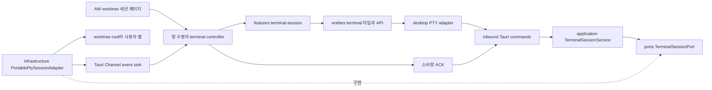

# AW 신규 PTY 터미널 패널 조사

- 조사일: 2026-10-13
- 대상: `/Users/yoophi/project/tauri-xterm-pty`, 현재 HEAD `a68ed16`
- AW 통합 위치: `apps/agentic-workbench`
- AW 조사 기준 HEAD: `760415c`
- 범위: 두 저장소의 소스·계약 확인, PoC 테스트 실행, 공식 문서 확인. AW 구현·릴리즈·설치는 수행하지 않았다.

## 결론

`tauri-xterm-pty`는 AW의 **worktree별 보조 Terminal 패널**로 통합할 수 있는 기반이다. React 19/Tauri 2와 FSD·헥사고날 구조가 AW와 맞고, 실제 PTY 입력·출력·resize·종료까지 구현돼 있다. 다만 그대로 복사하면 worktree 대신 앱의 cwd에서 시작하고, 다른 패널을 보거나 패널을 숨길 때 실행 중 셸이 종료된다. 따라서 cwd와 세션 수명을 먼저 수정해야 한다.

첫 구현은 **AW 데스크톱 프로세스가 소유하는 로컬 PTY + Tauri Channel**을 권장한다. embedded/external Workbench 모드와 독립적으로 동작하게 하고, 서버 세션·ACP agent run과 구분한다. 앱 종료 뒤 프로세스 유지, 다른 클라이언트 연결, 브라우저 터미널이 필요해질 때 서버 소유 방식을 검토한다. 이는 새로운 desktop capability를 명시적으로 추가하는 설계 제안이며, 기존 서버 호출을 임의로 우회하는 방식으로 구현해서는 안 된다.

기존 [이슈 #105](https://github.com/yoophi/agentic-workspace/issues/105)의 본문도 확인했다. worktree cwd, 대화형 명령·ANSI·resize, 페이지/터미널 종료 시 프로세스 정리, agent prompt로 출력 전달 검토가 이번 통합안과 일치한다. 이 이슈를 기반으로 구현 범위를 구체화하는 것이 적절하다.

AW의 기존 ACP `TerminalHandler`는 stdin을 null로 두고 stdout/stderr를 pipe로 수집한다. 실제 PTY와 사용자의 대화형 입력을 제공하는 이번 패널과 목적·수명이 다르므로 같은 “terminal” 명칭만으로 공유 세션으로 취급하지 않는다. [ACP terminal](/Users/yoophi/project/agentic-workspace/crates/acp-agent-core/src/infrastructure/acp/terminal.rs:70)

## PoC에서 확인한 기능

| 항목 | 구현과 근거 | AW 적용 판단 |
|---|---|---|
| 렌더링 | xterm 6, FitAddon, Unicode11Addon, WebGL addon. [package.json](/Users/yoophi/project/tauri-xterm-pty/package.json:20), [TerminalSurface](/Users/yoophi/project/tauri-xterm-pty/src/features/terminal-session/ui/terminal-surface.tsx:39) | options·font·renderer helper 재사용 가능 |
| 실제 셸 | portable-pty 0.9, 기본 셸 탐지, PTY 생성. [Cargo.toml](/Users/yoophi/project/tauri-xterm-pty/src-tauri/Cargo.toml:22), [adapter](/Users/yoophi/project/tauri-xterm-pty/src-tauri/src/infrastructure/portable_pty_session_adapter.rs:91) | AW 포트 뒤의 infrastructure adapter로 이식 가능 |
| 입출력 | 세션별 Channel, Uint8Array 출력, 64 KiB 입력 chunk. [API](/Users/yoophi/project/tauri-xterm-pty/src/entities/terminal/api/terminal-api.ts:21), [event sink](/Users/yoophi/project/tauri-xterm-pty/src-tauri/src/infrastructure/tauri_channel_terminal_event_sink.rs:34) | UTF-8 청크 경계 보존 구조 유지, ACK 추가 필요 |
| resize | ResizeObserver/FitAddon, 40 ms debounce. [surface](/Users/yoophi/project/tauri-xterm-pty/src/features/terminal-session/ui/terminal-surface.tsx:112) | 숨김→표시, 창 폭, 글꼴 크기 변경에 맞춰 보강 |
| 기본 검증 | UUID, 1–1000 cols/rows, 입력 상한. [domain](/Users/yoophi/project/tauri-xterm-pty/src-tauri/src/domain/terminal_session.rs:5), [service](/Users/yoophi/project/tauri-xterm-pty/src-tauri/src/application/terminal_session_service.rs:40) | 재사용하되 소유권·세션 수·전체 큐 상한은 별도 추가 |
| 종료 | 셸 종료 감지, SIGHUP, kill/wait, stop_all. [adapter](/Users/yoophi/project/tauri-xterm-pty/src-tauri/src/infrastructure/portable_pty_session_adapter.rs:175) | 다중 창 범위와 앱 Quit 처리를 AW에 맞게 변경 |
| 테스트 | frontend 6 files/9 tests, Rust 5 tests 모두 통과 | PoC의 기반 검증이며 AW 통합 검증은 아님 |

테스트 실행: `npm run check-types`, `npm test -- --reporter=dot`, `cargo test --manifest-path src-tauri/Cargo.toml`. 타입 검사도 통과했다. Rust 테스트에는 실제 셸 출력 marker와 종료 이벤트 확인이 포함된다. [PTY smoke test](/Users/yoophi/project/tauri-xterm-pty/src-tauri/src/infrastructure/portable_pty_session_adapter.rs:435)

README는 “셸 재시작”을 설명하지만 현재 `TerminalWorkspace` UI에는 `TerminalSurface` 하나만 있고 사용자 재시작 버튼은 없다. backend start/stop을 활용한 재시작 UI를 추가해야 한다. [현재 UI](/Users/yoophi/project/tauri-xterm-pty/src/features/terminal-session/ui/terminal-workspace.tsx:3)

## AW 통합 지점

현재 패널 ID는 `git/files/markdown/speckit`이다. `terminal` ID와 Terminal 아이콘·이름을 추가하고, worktree의 `path`를 넘기는 독립 feature를 보조 영역에 배치한다. [패널 타입](/Users/yoophi/project/agentic-workspace/apps/agentic-workbench/src/entities/worktree-workspace-layout/model/types.ts:1), [selector](/Users/yoophi/project/agentic-workspace/apps/agentic-workbench/src/features/worktree-workspace/ui/workspace-panel-selector.tsx:10)

선택 패널 자체는 page의 `useState("git")`이며 영속 저장된 상태가 아니다. 터미널 전용 분기를 page의 composition에서 분리하면 기존 `WorktreeWorkspacePanel`의 file watcher·query 조합까지 터미널을 위해 불필요하게 mount하지 않아도 된다. [page state](/Users/yoophi/project/agentic-workspace/apps/agentic-workbench/src/pages/project-worktree-session/ui/project-worktree-session-page.tsx:40), [기존 watcher](/Users/yoophi/project/agentic-workspace/apps/agentic-workbench/src/features/worktree-workspace/ui/worktree-workspace-panel.tsx:260)

`WorktreeWorkspacePanel`에는 자체 tab union, exhaustive split constraints, 마지막 `else`가 Speckit인 분기가 있다. terminal을 union에만 추가하면 기존 분기와 분할 설정이 맞지 않는다. 터미널은 내부 목록/상세 분할 없는 단일 surface이므로 기존 탭의 내부 split 설정과 분리한다. [union/constraints](/Users/yoophi/project/agentic-workspace/apps/agentic-workbench/src/features/worktree-workspace/ui/worktree-workspace-panel.tsx:147), [render 분기](/Users/yoophi/project/agentic-workspace/apps/agentic-workbench/src/features/worktree-workspace/ui/worktree-workspace-panel.tsx:300)

기존 레이아웃 저장 타입은 바깥 영역 폭과 종류별 내부 폭을 저장한다. Rust 내부 폭 저장은 `BTreeMap<String, u32>`이므로 새 키를 담을 수 있으나, 단일 터미널에 의미 없는 내부 폭을 저장하지 않는다. 기존 레이아웃 파일의 호환성을 유지한다. [TS 레이아웃](/Users/yoophi/project/agentic-workspace/apps/agentic-workbench/src/entities/worktree-workspace-layout/model/types.ts:8), [Rust 레이아웃](/Users/yoophi/project/agentic-workspace/apps/agentic-workbench/src-tauri/src/domain/worktree_workspace_layout.rs:12)

### 패널 위치 대안

| 위치 | 장점 | 변경 범위와 제약 | 권고 |
|---|---|---|---|
| 오른쪽 Workspace의 Terminal | 기존 selector·바깥 분할 폭·worktree context를 재사용 | 좁은 창에서 열 수가 줄고 Files/Git과 동시에 표시하기 어려움; terminal owner는 조건부 mount 밖에 필요 | 첫 구현 |
| 하단 도킹 패널 | 긴 명령·로그에 넓은 폭, Agent와 Files/Git을 동시에 확인 | 세로 분할 높이 저장·숨김·포커스·기존 가로 레이아웃 조합 추가 | 동시 표시 요구가 확인되면 확장 |
| 중앙 Agent 탭/타일에 Terminal | Agent와 터미널을 같은 작업 영역에서 배열 가능 | 현재 탭 props는 AgentRunPanelSlot에 묶임; 공통 presentation 타입과 terminal 분기가 필요하고 전체 프롬프트 전송 대상에서 제외해야 함 | 별도 workspace 일반화 이후 |

위 판단은 현재 세션 페이지가 가로 Agent/Workspace 분할을 사용하고 Agent 탭도 agent slot을 받는 구조에 근거한다. [page 조합](/Users/yoophi/project/agentic-workspace/apps/agentic-workbench/src/pages/project-worktree-session/ui/project-worktree-session-page.tsx:61), [Agent 탭 계약](/Users/yoophi/project/agentic-workspace/apps/agentic-workbench/src/features/agent-run/ui/agent-run-panel-tabs.tsx:7)

### 세션 수명과 화면 수명

PoC는 effect마다 UUID와 셸을 만들고 cleanup에서 stop을 보낸다. AW는 다른 탭 선택 시 내부 surface를 교체하며, 선택을 해제하면 보조 영역 전체를 unmount한다. 이를 그대로 결합하면 개발 서버·빌드·대화형 CLI가 패널 전환만으로 중단된다. [PoC 시작/정리](/Users/yoophi/project/tauri-xterm-pty/src/features/terminal-session/ui/terminal-surface.tsx:32), [AW 조건부 mount](/Users/yoophi/project/agentic-workspace/apps/agentic-workbench/src/pages/project-worktree-session/ui/project-worktree-session-page.tsx:77)

권장 MVP 정책:

- worktree 세션 창에서 Terminal을 처음 열 때만 셸을 시작한다.
- 패널 전환·숨김은 세션을 유지한다. terminal controller와 xterm 인스턴스를 보조 영역보다 오래 사는 창 단위 owner에 둔다.
- 최초 시작 이후 surface도 안정적으로 유지하는 구현이 가장 단순하다. 전체 보조 영역이 사라져도 terminal owner가 unmount되지 않아야 한다. 숨김 해제 때 fit/refresh하고 0 크기는 backend에 보내지 않는다.
- 명시적 종료, worktree 세션 창 종료, 앱 Quit에서 해당 PTY를 정리한다. 한 창을 닫아 다른 창의 PTY까지 stop_all하지 않는다.
- 앱 재시작·webview reload 후 프로세스 복원은 MVP에서 제공하지 않는다. reload에서는 이전 surface가 소유한 PTY를 정리한 뒤 새 셸을 시작하는 정책이 필요하다. 기존 창 incarnation이 reload 때 자동으로 바뀐다고 가정하지 말고, webview generation 또는 새 controller 연결 시 이전 소유 세션을 정리하는 handshake를 추가한다. JS cleanup과 창 Destroyed 이벤트만으로 reload 정리를 보장하지 않는다.
- 종료된 셸은 종료 상태·코드를 표시하며 “새 셸 시작”으로 새 ID를 만든다. 패널을 다시 열었다고 자동 재실행하지 않는다.

AW는 창 label 재사용을 대비해 incarnation을 관리한다. PTY owner에도 `(window label, incarnation, worktree path)`를 사용하고, UUID만으로 다른 창의 세션을 조작하지 못하게 한다. caller webview 정보는 inbound adapter가 주입하며 frontend의 owner 주장은 신뢰하지 않는다. [window lifecycle](/Users/yoophi/project/agentic-workspace/apps/agentic-workbench/src-tauri/src/infrastructure/window_lifecycle.rs:35)

## 권장 구조

프런트엔드는 `entities/terminal/{model,api}`와 `features/terminal-session/{model,ui}`를 유지하고, page는 조합만 담당한다. 전체 화면 `TerminalWorkspace`나 별도 PoC app/page를 통째로 가져오지 않는다. AW UI 프리미티브·테마·글꼴 설정을 사용하고 재사용 가능한 surface와 toolbar는 Storybook에 등록한다. cross-app 재사용 수요가 생기기 전에는 불필요한 packages 추출을 피한다.

특히 PoC wrapper의 `h-dvh w-screen`과 앱 전체 CSS는 패널에 그대로 복사하지 않는다. `TerminalSurface`의 `size-full`을 AW의 `min-h-0`/overflow 컨테이너에 맞춘다. Rust edition도 PoC 2024와 AW 2021이 달라 composition의 let-chain 등 문법을 이식 시 점검한다. [PoC wrapper](/Users/yoophi/project/tauri-xterm-pty/src/features/terminal-session/ui/terminal-workspace.tsx:5), [PoC manifest](/Users/yoophi/project/tauri-xterm-pty/src-tauri/Cargo.toml:6), [AW manifest](/Users/yoophi/project/agentic-workspace/apps/agentic-workbench/src-tauri/Cargo.toml)

Rust는 `domain`에 ID/size/owner/request/event/error, `ports`에 PTY와 event sink, `application`에 요청 검증·owner 확인·종료 정책, `infrastructure`에 OS/PTY/Channel, `inbound`에 DTO 변환을 둔다. Tauri·filesystem 세부 구현이 domain/ports로 들어가지 않도록 유지한다. PoC 서비스의 구조는 재사용하되 `StartTerminalRequest`에 승인된 worktree cwd와 owner를 추가해야 한다.

PoC options는 `allowProposedApi: true`, 고정 dark theme, font size 13을 사용한다. 필요한 proposed API를 특정하고 addon 버전과 함께 잠가 검증하며 AW의 글꼴 단계와 theme를 반영해야 한다. WebGL helper는 실패/context loss 시 addon을 해제해 기본 renderer로 돌아가는 구조다. 소스의 로그에는 “DOM renderer”라고 쓰지만 이번 조사에서 xterm 6의 구체적인 fallback renderer 종류는 검증하지 않았다. [options](/Users/yoophi/project/tauri-xterm-pty/src/features/terminal-session/model/terminal-options.ts:8), [font](/Users/yoophi/project/tauri-xterm-pty/src/features/terminal-session/model/terminal-font.ts:1), [renderer](/Users/yoophi/project/tauri-xterm-pty/src/features/terminal-session/model/webgl-renderer.ts:9)

### 외부 Workbench 서버와의 경계

AW 공용 transport는 `invoke(command, JSON args)`와 `listen(event, callback)` 계약이다. Tauri Channel 객체를 현재 HTTP 경로의 JSON 인자로 넘길 수 없으므로 PoC API를 공용 transport에 붙이는 것만으로 외부 모드를 지원할 수 없다. [transport 계약](/Users/yoophi/project/agentic-workspace/apps/agentic-workbench/src/shared/api/transport/transport.ts:13)

기존 정적 검사는 Tauri 직접 호출을 desktop allowlist로 제한한다. 앱 로컬 PTY를 도입하려면 **새 desktop capability의 소유권·수명·API를 문서화하고 allowlist와 해당 테스트를 함께 확장**해야 한다. 이는 서버 소유 command의 재분류와 다르다. browser-only UI에는 unavailable 상태를 제공한다. [직접 invoke 제한](/Users/yoophi/project/agentic-workspace/apps/agentic-workbench/src/shared/api/transport/no-direct-invoke.test.ts:1)

앱 Quit은 `Destroyed` 없이 `Exit`만 올 수 있으며, 외부 모드 종료는 서버 작업대를 유지한다. 로컬 PTY 종료를 서버 agent run 취소와 혼합하지 않고 모든 모드의 앱 종료 경로에서 수행해야 한다. [AW 종료 경로](/Users/yoophi/project/agentic-workspace/apps/agentic-workbench/src-tauri/src/lib.rs:411)

서버 소유 방식을 선택하면 Workbench protocol·서비스·HTTP command·인증된 출력 구독·desktop bridge를 함께 확장해야 한다. 스트림 sequence, bytes, 소비 ACK, 재연결/유실 정책, writer 소유권, window retirement 처리가 추가된다. 기존 agent 이벤트 replay에 PTY raw 출력만 끼워 넣으면 ANSI 상태 복원과 대량 출력 문제를 해결하지 못한다.

| 방식 | 이점 | 추가 비용·제약 | 판단 |
|---|---|---|---|
| 앱 로컬 PTY + Channel | PoC 재사용이 크고 external 서버 업데이트와 독립 | 새 desktop capability 계약 필요, 앱 종료 시 종료, 브라우저 미지원 | 첫 단계 권장 |
| 서버 소유 PTY + 인증 스트림 | 여러 클라이언트·앱 재연결 확장 가능 | 계약/권한/흐름 제어/복원/배포 일괄 변경 | 지속 실행 요구가 생길 때 |
| 외부 Terminal 앱 열기 | 유지보수 부담 낮음 | AW 패널 내 출력·입력·resize 불가 | fallback 용도 |

Tauri 공식 문서는 일반 event보다 streaming용 Channel을 권장한다. 그렇더라도 Channel 전송 성공이 xterm 렌더링 소비 완료를 보장하는 것은 아니다. [Tauri frontend 호출 문서](https://v2.tauri.app/develop/calling-frontend/)

## 필수 보강과 위험

### cwd와 셸 환경

PoC adapter의 cwd는 `std::env::current_dir()`이다. 시작 요청에 worktree 경로를 추가하고 실제 디렉터리 존재·owner의 worktree와의 일치 여부를 backend에서 확인한다. UI로 자유 형식 실행 파일/command string을 받는 API보다 사용자 기본 셸 프로필부터 시작한다. cwd를 문자열 `cd` 입력으로 흉내 내지 않고 `CommandBuilder.cwd`에 전달한다. [현재 cwd](/Users/yoophi/project/tauri-xterm-pty/src-tauri/src/infrastructure/portable_pty_session_adapter.rs:96)

PoC는 Unix에서 `$SHELL` 또는 `/bin/sh`를 쓰며 login shell 인자를 지정하지 않는다. Finder로 실행한 ad-hoc 설치 앱에서 PATH·Node·npx·사용자 shell 초기화가 기대대로 동작하는지 실제 확인해야 한다. login/interactive 프로필 정책은 셸 종류별로 정의하고 공통 문자열 인자를 가정하지 않는다. `TERM_PROGRAM`은 AW 이름으로 변경한다. [탐지](/Users/yoophi/project/tauri-xterm-pty/src-tauri/src/infrastructure/system_terminal_environment_provider.rs:29), [환경 설정](/Users/yoophi/project/tauri-xterm-pty/src-tauri/src/infrastructure/portable_pty_session_adapter.rs:271)

### 출력과 입력의 흐름 제어

현재 입력은 unbounded `mpsc::channel`에 쌓이고, 한 command loop가 `writer.write_all`을 수행한다. 64 KiB는 요청별 상한일 뿐 전체 backlog 상한이 아니다. 자식이 입력을 소비하지 않으면 write가 막히고 뒤에 있는 Stop·Resize가 처리되지 않을 수 있다. 제어 명령과 blocking 입력 쓰기를 분리하고, bounded input queue·paste 상한·취소 가능한 writer를 설계한다. [queue 생성](/Users/yoophi/project/tauri-xterm-pty/src-tauri/src/infrastructure/portable_pty_session_adapter.rs:116), [write loop](/Users/yoophi/project/tauri-xterm-pty/src-tauri/src/infrastructure/portable_pty_session_adapter.rs:215)

출력 reader는 8 KiB씩 읽어 즉시 보내며 frontend는 `terminal.write`만 한다. 소비 ACK와 출력 queue 상한이 없다. xterm write callback 이후 소비 바이트를 ACK하고 high/low watermark에 따라 reader의 추가 읽기를 제한한다. 종료·취소 경로는 ACK 대기와 독립적으로 깨어나야 한다. 숨겨진 terminal도 소비를 계속하거나 명시적으로 제한해야 한다. [reader](/Users/yoophi/project/tauri-xterm-pty/src-tauri/src/infrastructure/portable_pty_session_adapter.rs:278), [frontend write](/Users/yoophi/project/tauri-xterm-pty/src/features/terminal-session/ui/terminal-surface.tsx:62)

xterm 공식 문서는 빠른 출력이 비동기 write buffer를 압박할 수 있어 소비 callback 기반 흐름 제어를 설명한다. 따라서 10,000줄 scrollback이나 8 KiB chunk 크기만으로 메모리 상한을 보장하지 않는다. [xterm flow control](https://xtermjs.org/docs/guides/flowcontrol/)

### 프로세스 종료

PoC는 Unix에서 foreground process group과 셸에 SIGHUP을 보내고 200 ms 후 child.kill을 수행한다. 이는 협조하지 않는 descendant·다른 process group·daemonized 프로세스 전체 종료를 보장하지 않는다. `reader_thread.join()`도 자식이 PTY를 계속 잡고 있으면 끝나지 않을 수 있다. 종료 그룹·추적 범위와 bounded cleanup을 정하고 foreground TUI, background 서버, HUP 무시 프로세스를 별도로 검증한다. Windows 프로세스 트리 정리는 별도 정책이 필요하다. [종료 구현](/Users/yoophi/project/tauri-xterm-pty/src-tauri/src/infrastructure/portable_pty_session_adapter.rs:253), [signal 구현](/Users/yoophi/project/tauri-xterm-pty/src-tauri/src/infrastructure/portable_pty_session_adapter.rs:340)

PoC의 창 닫기 handler는 모든 세션에 `stop_all`을 호출한다. AW는 여러 세션 창을 지원하므로 이 handler를 복사하면 다른 worktree 셸까지 종료한다. 창별 stop과 앱 전체 shutdown을 구분하고, idempotent stop·start 도중 close race·실패한 spawn의 자원 정리를 확인한다. [PoC 창 종료](/Users/yoophi/project/tauri-xterm-pty/src-tauri/src/lib.rs:29)

frontend의 `reportError`는 stdin만 비활성화하며 backend stop을 보장하지 않는다. resize/transport/input 실패를 각각 구분하고 회복 가능한 오류와 종료 상태를 분리해야 한다. 사용자에게 종료로 표시한 뒤 셸이 계속 살아 있는 상태를 피한다. [frontend 오류 처리](/Users/yoophi/project/tauri-xterm-pty/src/features/terminal-session/ui/terminal-surface.tsx:48)

### 권한과 출력 처리

UUID 형식 검증은 인증이 아니다. 모든 write/resize/stop/ACK에서 caller 창과 incarnation의 소유권을 검증하고 세션 수·입력 큐·출력 큐·scrollback 상한을 둔다. 세션 창에서만 terminal command가 가능하도록 권한 경계를 정의한다. shell은 사용자 권한으로 실행하며 AW의 ACP permission mode와 동일한 승인 정책이 적용되는 것으로 표시하지 않는다.

출력·선택 텍스트·title·링크는 신뢰하지 않는 데이터로 취급한다. MVP에 임의 OSC handler·HTML 주입·자동 clipboard 쓰기·자동 링크 실행을 추가하지 않는다. 이후 링크 기능은 scheme 검증과 명시적 사용자 동작을 통해 기존 외부 URL 경로로 연결한다. 비밀 입력·raw terminal 출력을 분석/로그/완료 알림에 담지 않는다. terminal과 같은 JS 문맥의 코드가 입력에 접근할 수 있다는 점은 xterm 공식 보안 문서에서도 강조한다. [xterm security](https://xtermjs.org/docs/guides/security/)

## 단계별 제안

1. **기반 통합:** `terminal` selector, worktree cwd, 기본 셸, 입력·출력·resize, 종료 상태와 재시작 버튼. 단일 terminal/worktree 세션 창. 창 owner·incarnation·앱 Quit 정리, bounded queue/ACK를 함께 구현한다.
2. **일상 사용성:** AW 테마·글꼴 설정 연결, 복사/붙여넣기·IME·단축키, 검색, 선택 출력의 명시적 agent prompt 전달, 추가 터미널 탭. agent 자동 실행·관찰 도구는 별도 기능으로 취급한다.
3. **지속 실행 확장:** 명확한 요구가 있을 때 서버 PTY, 재연결, 화면 snapshot/serialization, writer lease, 여러 클라이언트. 셸 내부 개별 명령 상태는 shell integration을 통해 추가하며 현재 셸 exit code와 혼동하지 않는다.

## 구현 완료 판정 기준

| 검증 | 통과 조건 |
|---|---|
| cwd | main worktree/child worktree에서 `pwd`가 실제 선택 경로와 일치 |
| 수명 | build/dev server 실행 중 Git 패널 전환·전체 보조 영역 숨김·재표시 후 동일 프로세스와 출력 유지 |
| 다중 창 | 같은/다른 worktree 창의 ID가 분리되고 타 창 ID로 write/resize/stop 불가, 한 창 종료 시 다른 창 유지 |
| 시작 race | StrictMode·빠른 열기/닫기·start 실패에서 중복 셸·reader·registry 누수 없음 |
| 크기 | resize·최소 폭·숨김 복귀·폰트 변경 후 `stty size`와 xterm 크기 일치, 0 크기 요청 없음 |
| 입력 | 한글 IME·UTF-8 청크 경계·다중 줄 paste·Ctrl+C·Ctrl+D·TUI 키 조작 정상 |
| 출력 부하 | `yes` 부하 중 입력/종료 반응, backend·IPC·xterm queue가 설계한 상한 이내; 측정 기준은 구현 전에 확정 |
| 종료 | foreground·background·HUP 무시·blocked input 경우 닫기/Quit이 상한 내 완료, 정리 정책 밖 프로세스는 명확하게 정의 |
| 런타임 | embedded/external 모드에서 동일 로컬 terminal 동작, browser-only에서 unavailable 상태 |
| 실제 설치 | ad-hoc macOS 설치 앱을 Finder에서 실행해 shell/PATH/Node/npx, WebGL fallback 검증 |
| 회귀 | 기존 패널 selector/폭 저장·transport direct invoke guard·창 lifecycle·Storybook·타입/Rust 검사 통과 |

## 미확정 사항

- 사용자가 원하는 프로세스 유지 범위: 패널 숨김만 유지할지, 앱 종료 이후까지 유지할지. 본 권고는 숨김 유지·창/앱 종료 시 정리다.
- shell profile/login 정책, 기본 scrollback·세션 수·queue 상한, 대용량 출력의 허용 지연 수치.
- Windows/Linux 실제 PTY와 descendant 정리: 이번 테스트는 현재 macOS 환경에서만 실행했다.
- PoC 라이선스: README는 아직 미정으로 명시한다. 동일 소유자의 내부 재사용 여부와 별도로 배포 시 출처·라이선스 정책을 확정해야 한다. [README](/Users/yoophi/project/tauri-xterm-pty/README.md)
- PoC의 기존 Code OSS 비교 문서는 관련 아이디어를 제공하지만 본 조사의 기능 판정은 현재 소스를 직접 확인했다. AW 구현이 Code OSS 수준의 셸 통합·재연결을 이미 제공한다는 뜻은 아니다.

## td 구현 작업 등록

2026-10-13 기존 [gh-105](https://github.com/yoophi/agentic-workspace/issues/105)를 feature로 전환하고 조사 범위를 추가했다. 아래 task는 모두 P2/open이며 구현 완료를 의미하지 않는다.

| Task | 구현 범위 | 선행 task |
|---|---|---|
| [gh-220](https://github.com/yoophi/agentic-workspace/issues/220) | 데스크톱 PTY 계약·소유권·worktree cwd 구현 | 없음 |
| [gh-221](https://github.com/yoophi/agentic-workspace/issues/221) | PTY 수명·창별 정리·프로세스 종료 구현 | gh-220 |
| [gh-222](https://github.com/yoophi/agentic-workspace/issues/222) | bounded 입출력·소비 ACK·독립 제어 구현 | gh-220 |
| [gh-223](https://github.com/yoophi/agentic-workspace/issues/223) | Workspace 패널·lazy xterm·세션 유지 UI 구현 | gh-220, gh-221, gh-222 |
| [gh-224](https://github.com/yoophi/agentic-workspace/issues/224) | 통합 회귀·설치 앱 PTY 검증 | gh-221, gh-222, gh-223 |
