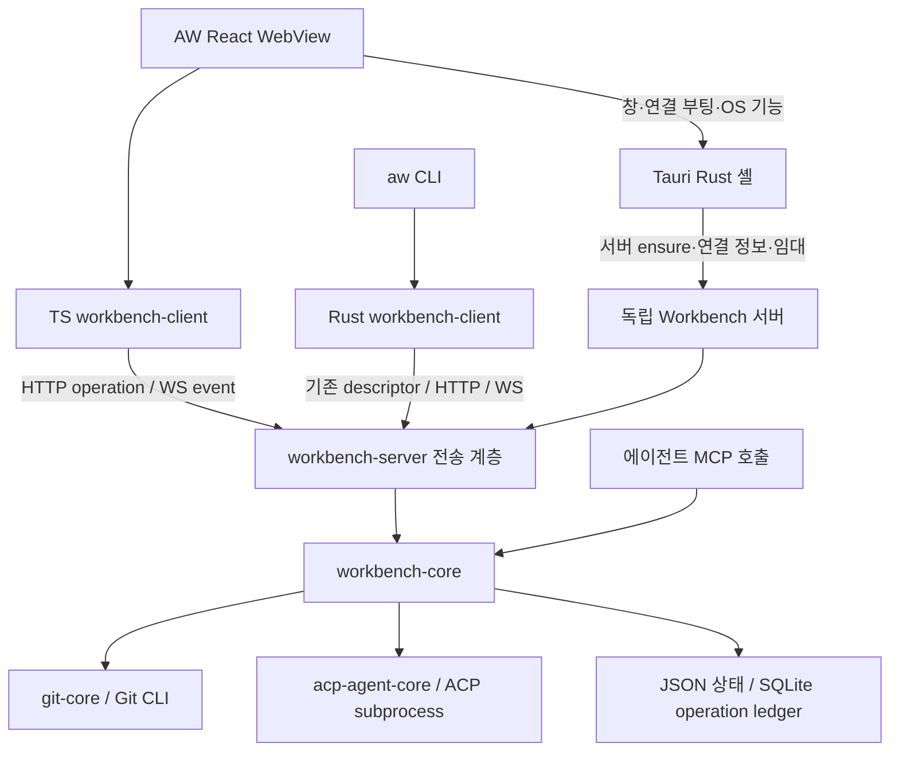

# Agentic Workspace 프로젝트 구조 조사

- 조사일: 2026-10-12, 로컬 소스 기준.
- 경로: `/Users/yoophi/project/agentic-workspace`.
- HEAD: `52d328b13bbf4bdcf73f9b0541f446e3664eb571`.
- 범위: manifest, 실제 진입점·통신·저장 구현 및 문서 비교. 설치·빌드·테스트·앱 실행은 하지 않았다.
- 기존 미추적 파일 `docs/code-oss-chat-aw-binding-plan.md`, `docs/code-review-app-migration.md`, `goal.md`는 수정하지 않았다.

## 핵심 구조

**Tauri 데스크톱 앱 5개, 별도 Rust 앱 2개, TypeScript 공유 패키지 8개, Rust 공유 crate 7개**로 구성된 모노레포다. AW는 기본적으로 독립 Workbench 서버에 붙는 클라이언트이며, 앱 내부에서 모든 업무를 실행하는 구조로만 설명하면 현재 코드와 다르다.

| 디렉터리 | 역할 |
|---|---|
| `apps/` | 5개 데스크톱 앱의 React·Tauri 코드, Workbench 서버 및 `aw` CLI |
| `packages/` | UI·Markdown·Git·에이전트·Workbench 통신 TypeScript 재사용 모듈 |
| `crates/` | Git·ACP 런타임·Workbench 계약·구현·호스트·서버·Rust 클라이언트 |
| `docs/` | 한국어 조사·설계·ADR·에이전트 운영 규칙 |
| `specs/` | 기능별 SpecKit 산출물, 계약, 검증 및 진행 기록 |
| `openwiki/` | 자동 생성되는 탐색 문서. 일부 구조 설명이 최신 코드보다 오래됨 |
| `scripts/`, `.github/workflows/` | 릴리스, 실제 서버 wire 검증, 품질 및 OpenWiki 갱신 자동화 |

근거: [Cargo workspace](../Cargo.toml), [pnpm workspace](../pnpm-workspace.yaml), [저장소 규칙](../AGENTS.md), [컨텍스트 맵](../CONTEXT-MAP.md).

## 루트 도구와 기술 스택

- 프론트엔드: pnpm `9.10.0` + Turbo `^2.5.8`, React·TypeScript·Vite. AW/AC/GE/MA는 React 19 계열이며 **HL은 React 18.3.1**이다. 버전은 manifest 선언 범위이며 설치본 검증 결과는 아니다.
- UI: 대부분 Tailwind 4, shadcn 스타일 컴포넌트. AW는 Radix, MA는 Base UI를 사용하며 공용 Markdown React 모듈에 UI 어댑터를 주입한다.
- 네이티브: Tauri 2 + Rust Cargo workspace. ACP 의존성은 `agent-client-protocol` `0.15.0`.
- 서버: Axum 0.7, Tokio, HTTP + WebSocket. Workbench 계약은 Rust `utoipa` OpenAPI → `openapi-typescript`로 TS 타입을 생성한다.
- 검증: Vitest, Storybook, Cargo test/Clippy/fmt. CI는 Node 22·Rust stable·macOS 15에서 계약 drift, 타입·테스트·빌드를 확인하도록 설정돼 있다.
- 루트 `dev`/`tauri:dev`의 기본 대상은 AW. HL 개발은 `pnpm --filter @yoophi/hushline tauri:dev`처럼 직접 대상 패키지를 지정한다.

근거: [루트 package.json](../package.json), [Turbo 작업](../turbo.json), [품질 CI](../.github/workflows/quality.yml).

## 앱별 책임과 현재 구현 상태

| 앱 | 현재 책임 | 주요 공유 의존성 |
|---|---|---|
| AW `agentic-workbench` | 프로젝트·Git worktree, ACP 세션, 목표·프롬프트·설정, 변경사항/Markdown 미리보기, Coordinator/Child 오케스트레이션 UI | Git·Markdown·ACP·Workbench 관련 TS/Rust 모듈 |
| AC `ask-code` | 저장소/소스/질문 3패널 화면 **초기 골격**. 저장소 열기 버튼 비활성, 패널 안내문 표시 | TS `ui`, `agent-client`; Rust `acp-agent-core` |
| GE `git-explorer` | 저장소 등록, 커밋 그래프·상세·diff, 작업 트리 변경 감시 | `git-core`, `git-graph`, `git-ui`, `ui`, `workspace-auto-refresh` |
| MA `markdown-annotator` | Markdown 열기·미리보기, 블록/인라인 주석, TOC·Mermaid, 에이전트 프롬프트 내보내기, 문서 감시·창/탭·`ma` launcher | `markdown-annotation-core/react`, `workspace-auto-refresh` |
| HL `hushline` | YouTube 음성 수집 → Whisper 자막 → ACP 에이전트 정리 | `acp-agent-core`, `agent-client`; 외부 yt-dlp·ffmpeg·whisper 도구 |
| `agentic-workbench-server` | 독립 서버 composition root. `serve`, `ensure`, `status`, `stop` 명령 | `workbench-host` |
| `aw-cli` (`aw` binary) | 기존 서버의 operation 조회·호출, 허용된 이벤트 JSONL 구독 | Rust `workbench-client`, `workbench-protocol` |

AC는 Rust 상태 등록·창 종료 시 run 취소만 연결돼 있고 `invoke_handler`가 없다. 계획된 코드 질문 기능을 완성된 기능으로 간주하지 않는다. `aw`는 서버를 자동 시작하지 않으며 현재 admission 정책상 저장 데이터 조회·일부 비실행 변경 중심이다. run 시작/취소·Git helper·server stop 등은 선행 조건 미충족으로 차단된다.

근거: [AC 화면](../apps/ask-code/src/pages/ask-code/ui/AskCodePage.tsx), [AC 셸](../apps/ask-code/src-tauri/src/lib.rs), [서버 main](../apps/agentic-workbench-server/src/main.rs), [CLI 안내](workbench-rust-client-cli.md), [클라이언트 admission](../crates/workbench-client/src/application/admission.rs).

## 브라우저 영역과 네이티브/서버 영역

여기서 브라우저 영역은 **Tauri WebView의 React 프론트엔드**다. Hubble의 `apps/www`와 같은 독립 웹 앱은 현재 앱 목록에 없다. Vite 프론트엔드 개발 서버가 있다는 사실만으로 OS 기능을 갖춘 독립 브라우저 앱이 되는 것은 아니다.

| 기능 | 브라우저/WebView | Rust 셸·서버 |
|---|---|---|
| 화면·상태 | 라우팅, 패널, 선택·스크롤, Query/Zustand 상태, 사용자 입력 | 창 생성/종료, 메뉴·대화상자, 셸 표현 설정 |
| Markdown | AST 파싱, 렌더링, 주석 앵커·편집, TOC·Mermaid, 프롬프트 생성 | 파일 읽기·감시, 네이티브 탭·CLI launcher |
| Git | 그래프 레이아웃, diff·히스토리·변경사항 표시 | Git CLI 실행, 파일시스템 감시 |
| 에이전트 | 메시지·툴·권한 UI, run 이벤트 반영 | ACP subprocess/stdin/stdout, 세션·권한 처리, 오케스트레이션 |
| AW 업무 상태 | transport 어댑터를 통한 operation 요청·이벤트 구독 | Workbench의 프로젝트·목표·프롬프트·설정·Bench 소유·저장 |
| HL 전사 | 큐·진행률·자막·정리 결과 표시 | 다운로드·변환·Whisper 실행, ACP 정리 |

FSD의 `app/pages/features/entities/shared/components/ui`와 Rust 헥사고날의 `domain/ports/application/infrastructure/inbound`는 저장소 규칙이다. GE는 `adapters/inbound/outbound`, HL은 `adapters`와 평면 모듈을 사용하므로 모든 앱이 동일한 디렉터리 형태를 갖지는 않는다.

## AW 서버·CLI 통신 흐름

1. 기본 `external` 모드에서 Tauri 셸은 데이터 디렉터리별 서버를 찾거나 시작한다. runtime·MCP·HTTP 조립과 소유 잠금·descriptor·임대·유휴 종료는 `workbench-host`가 담당한다.
2. WebView는 Tauri 명령으로 모드·연결 정보를 얻고 handshake 후 HTTP transport를 선택한다. 연결 실패 시 실패 상태가 되며 업무 command 호환 경로로 자동 우회하지 않는다.
3. 업무 호출은 `/v1/calls`, 이벤트는 ticket 발급 후 `/v1/events` WebSocket으로 전달한다. 창 principal, server epoch, cursor·gap·snapshot 회복을 관리한다.
4. `AW_WORKBENCH_MODE=embedded`를 명시한 개발·시험 경로만 앱 내부 runtime과 HTTP 서버를 조립하고 초기 연결 실패 시 Tauri compat 경로를 허용한다.
5. `aw`는 기존 descriptor의 서버 identity·권한을 확인하여 같은 계약을 호출한다. 독립 Rust client에는 core/host/server/Tauri production 의존성이 없다.

근거: [모드 결정](../apps/agentic-workbench/src-tauri/src/infrastructure/workbench_mode.rs), [프론트엔드 bootstrap](../apps/agentic-workbench/src/app/bootstrap-transport.ts), [호스트 조립](../crates/workbench-host/src/assembly.rs), [HTTP 라우트](../crates/workbench-server/src/lib.rs).

## 공유 모듈 목록

| TypeScript 패키지 | 책임 / manifest의 주요 소비자 |
|---|---|
| `ui` | 공용 UI 프리미티브 / AC·GE |
| `git-graph` | Git 타입·커밋 그래프 레이아웃 / AW·GE·git-ui |
| `git-ui` | Git 그래프·변경사항·diff React UI / AW·GE |
| `markdown-annotation-core` | AST 블록·주석 타입·TOC·프롬프트 포맷 / AW·MA·react 패키지 |
| `markdown-annotation-react` | Markdown 뷰어·주석 UI·Mermaid·TOC / AW·MA |
| `workspace-auto-refresh` | 감시 이벤트·자동 새로고침·선택 유효성 유틸 / AW·GE·MA |
| `agent-client` | ACP run 타입과 Tauri invoke/listen 래퍼 / AW·AC·HL |
| `workbench-client` | 생성 계약, HTTP 호출·연결·WebSocket 이벤트 회복 / AW |

| Rust crate | 책임 |
|---|---|
| `git-core` | Git 도메인·포트·CLI 구현; AW·GE 및 workbench-core에서 사용 |
| `acp-agent-core` | Tauri 없는 ACP 실행 domain·ports·application·infrastructure; AW·AC·HL 및 core/host에서 사용 |
| `workbench-protocol` | DTO·operation·principal·fault·event·Workbench trait·OpenAPI |
| `workbench-core` | 업무 use case, authorization·멱등성·Bench 소유, 런타임·저장·이벤트 |
| `workbench-server` | HTTP/WS·인증·ticket·drain 전송 어댑터; protocol에 의존 |
| `workbench-host` | core/server/MCP 조립 및 독립 서버 생명주기 |
| `workbench-client` | 기존 서버 연결·호출·이벤트·retry-state, production activation 정책 |

**`agent-client`와 `workbench-client`는 다른 경계다.** 전자는 ACP run용 Tauri 계약이고 후자는 Workbench 서버의 HTTP/WS 클라이언트다. MA/AW 공유 Markdown 모듈도 문서 뷰잉·주석·프롬프트 생성용으로, Hubble의 TipTap 같은 rich text 편집기·파일 저장 계층 전체를 제공하지 않는다.

## 저장 및 문서와 코드의 차이

- Workbench 프로젝트·프롬프트·목표·설정은 JSON 파일, 변경 의도·결과는 `workbench/ledger.sqlite`에 저장한다. run 이벤트 journal은 메모리 보관이며 서버 재시작 후 상태 재조회가 필요하다. [데이터 경로](../crates/workbench-core/src/infrastructure/data_paths.rs), [런타임](../crates/workbench-core/src/application/workbench_runtime.rs).
- OpenWiki는 앱 4개·TS 패키지 7개·Rust 공유 crate 2개 중심으로 기술해 AC·독립 서버·CLI·Workbench 모듈을 누락한다. 현재 숫자는 5/8/7이다. [OpenWiki 아키텍처](../openwiki/architecture.md).
- OpenWiki의 “데이터베이스 없음”은 현재 SQLite operation ledger와 다르며, Tauri 이벤트 중심 설명만으로 AW 기본 HTTP/WS 흐름을 설명할 수 없다.
- OpenWiki 검증 예시 `pnpm run checktypes`는 루트에 없다. 실제 명령은 `pnpm run check-types`다. [퀵스타트](../openwiki/quickstart.md), [루트 scripts](../package.json).
- 루트 Cargo 주석의 “공유 git-core와 두 Tauri 앱” 역시 members와 다르다. 최신 판단에는 문서 설명보다 manifest·진입점·실제 정책을 우선한다.

## 탐색 시작점

- 화면 구성: 각 앱 `src/main.tsx` → AW [App.tsx](../apps/agentic-workbench/src/app/App.tsx), AC [app/index.tsx](../apps/ask-code/src/app/index.tsx).
- AW 경계: [bootstrap-transport.ts](../apps/agentic-workbench/src/app/bootstrap-transport.ts) → [command-table.ts](../apps/agentic-workbench/src/shared/api/transport/command-table.ts) → [WorkbenchRuntime](../crates/workbench-core/src/application/workbench_runtime.rs).
- 계약·저장·서버: [protocol](../crates/workbench-protocol/src/lib.rs), [컨텍스트 용어](../crates/workbench-core/CONTEXT.md), [host](../crates/workbench-host/src/lib.rs), [서버 진입점](../apps/agentic-workbench-server/src/main.rs).
- 후속 설계 읽기: [Workbench seam](workbench-seam.md), [Rust client/CLI](workbench-rust-client-cli.md), [서버-클라이언트 조사](client-server-architecture-research.md). 계획과 완료 범위는 해당 코드 및 spec 검증 기록과 함께 확인한다.
