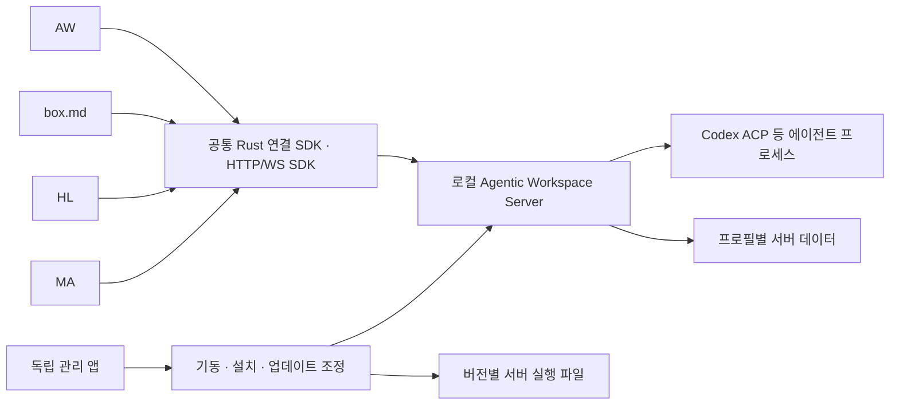
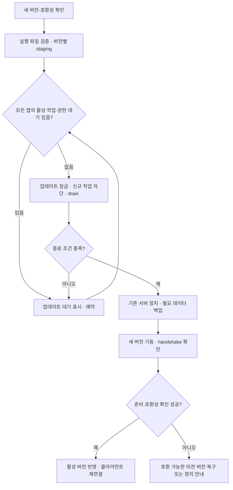

# 공용 에이전트 서버 독립 앱 배포 계획

작성일: 2026-10-14. 상태: 구현 전 계획. 대상: AW, MA, HL, box.md.

## 목표와 결정

`agentic-workbench-server`를 독립 설치·업데이트할 수 있는 공용 로컬 서비스로 배포한다. AW·MA·HL·box.md는 같은 서버를 사용하되 각 앱의 문서·작업대·대화·권한 경계를 유지한다. 서버 실행 파일의 현재 이름은 유지하고 제품 표시명은 가칭 **Agentic Workspace Server**로 한다. 이름 변경과 프로토콜 재작성은 이번 전환의 전제가 아니다.

첫 배포는 macOS의 사용자 계정 단위 서비스와 작은 관리 앱이다. 관리자/root 서비스나 원격 네트워크 공개는 포함하지 않는다. 개발·로컬 사용 배포는 **ad-hoc 서명**으로 작성한다. Payhere Inc 팀 계정·인증서·공증 자격 증명은 사용하지 않는다. 외부 배포용 서명 정책은 별도 결정 사항이다.

기존 서버 프로세스 분리(044)를 재구현하지 않는다. 다음 증분의 핵심은 공용 설치 위치·기동 책임·업데이트 조정과 여러 소비 앱의 통합이다. 최초 구현은 AW와 box.md를 기준으로 검증한 뒤 HL, MA 순서로 확장한다.

## 현재 확인된 기반과 부족한 부분

기준 AW 커밋: `760415c`. box.md는 작성일의 로컬 소스를 확인했다. 아래는 소스 확인 결과이며 네 앱을 동시에 실행한 통합 검증 결과가 아니다.

| 영역 | 현재 상태 | 이번 계획의 변경 |
|---|---|---|
| 서버 | [독립 CLI composition root](../apps/agentic-workbench-server/src/main.rs), `serve/ensure/status/stop` | 독립 설치 산출물과 관리 앱 제공 |
| 생명주기 | [044](../specs/044-standalone-server/spec.md): 데이터 디렉터리별 단일 writer, 안내 파일, 신원 확인, 임대, 유휴 종료·drain | 공용 설치 및 업데이트 조정자 연결 |
| Rust 클라이언트 | [workbench-desktop-client](workbench-desktop-client.md): 서버 탐색, 창 토큰, 임대, 재연결, 앱 종료 시 임대 해제 | 공용 설치 탐색과 관리/일반 소비자 역할 분리 |
| 채팅 SDK | [workbench-agent-client](shared-http-agent-client.md): HTTP/WS, 채팅·권한 상태, unknown 결과, 이벤트 복구 | HL·MA 소비 Adapter 추가, 외부 저장소 배포 계약 확정 |
| AW | external 모드 기본, 실행 파일은 명시 경로 → 앱 옆 → 개발 target 순서로 탐색 | 독립 설치 서버를 우선 사용, 번들 서버 단계적 제거 |
| box.md | `apps/box-desktop/src-tauri/src/infrastructure/workbench_shell.rs`는 기본 AW 데이터 디렉터리를 사용. `scripts/prepare-workbench-server.mjs`는 vendor 소스로 서버를 빌드·번들 | 공용 서버 연결 후 자체 서버 빌드·번들 제거 |
| HL | `src-tauri/src/adapters/agent.rs`에서 acp-agent-core 직접 실행, `@yoophi/agent-client` Tauri 계약 소비 | 채팅·문서 정리의 실행을 공용 HTTP 서비스로 전환 |
| MA | 현재 Tauri Cargo dependencies에 공용 서버/ACP 연결 없음 | 문서 기반 채팅용 연결·컨텍스트 Adapter 신설 |

box.md 경로는 별도 저장소 `../box.md` 기준이다. 이 PR은 해당 저장소 파일을 변경하지 않는다. [기존 전체 전환 조사](client-server-architecture-research.md), [독립 서버 ADR](adr/0009-standalone-server-and-owner-principal.md), [데스크톱 계약](../specs/044-standalone-server/contracts/desktop-client.md)을 이어받는다.

## 구성과 책임

| 구성 | 책임 |
|---|---|
| 서버 daemon | ACP 실행, 작업대/run, 권한 요청, 이벤트, 서버 소유 데이터, 활성 작업·임대 판정 |
| 관리 앱과 공용 기동 계층 | 설치 상태, 호환 버전 선택, 서버 시작, 업데이트 예약·적용, 로그·진단, 명시적 정지 |
| Rust SDK/native shell | 설치 발견, 인증된 handshake, 소비자 등록, 창 identity·토큰·임대, 종료 처리 |
| HTTP/WS SDK | typed call/events, 이벤트 순번·gap·재연결, unknown 처리, 채팅 facade |
| 각 앱 | 문서·주석·음성·프로젝트 UI, 컨텍스트 선택, 앱 데이터, native 메뉴/창/파일 선택 |

관리 앱의 창을 닫아도 daemon과 다른 앱의 작업을 종료하지 않는다. 소비 앱은 공용 기동 계층에 시작을 요청할 수 있으나 다른 앱의 서버를 정지·업데이트하는 관리 API 권한은 기본으로 갖지 않는다. login 자동 시작은 사용자가 선택하는 옵션으로 둔다. 유휴 시에는 기존 정책으로 종료하고 다음 소비 요청에서 다시 기동할 수 있다.

## 설치·발견·프로필 정책

1. 공용 사용자 설치 registry에 채널·버전·실행 파일 위치·체크섬·API major·capability 정보를 저장한다. 경로와 manifest는 native 계층에서 검증한다. registry에는 인증 토큰을 넣지 않는다.
2. 클라이언트는 선택한 데이터 프로필의 살아 있는 서버 안내 파일을 먼저 확인하고 인증된 handshake로 호환성을 판정한다. 호환 서버가 있으면 새 프로세스를 시작하지 않는다.
3. 서버가 없을 때 실행 파일 선택은 명시 개발 override → 공용 설치 registry → 전환 기간의 앱 번들 → 개발 target 순서다. 명시 override 오류는 숨기지 않는다.
4. 서버가 살아 있지만 비호환이면 이유와 필요한 업데이트를 표시한다. 같은 데이터 디렉터리에 다른 writer를 띄우거나 기존 서버를 자동 종료하지 않는다.
5. 초기 안정 프로필은 기존 AW 데이터 디렉터리를 유지한다. 관리 앱의 app-data 경로를 서버 데이터 경로로 자동 바꾸지 않는다. 개발·RC는 명시적으로 별도 프로필을 사용한다.
6. 공용 설치가 없으면 설치/관리 앱 열기 안내를 제공한다. 일반 클라이언트가 백그라운드에서 임의 서버 다운로드·실행을 하지 않는다.

한 사용자라도 다른 프로필은 별도 서버를 가질 수 있다. 따라서 단일 서버의 기준은 **사용자·채널·프로필·데이터 디렉터리**다. 전환 중 구버전 앱의 bundled ensure도 기존 single-writer lock에 따라 거절되거나 살아 있는 서버를 재사용해야 한다.

## 앱별 identity와 권한

현재 native 연결 계층은 owner credential을 사용해 창 토큰을 발급한다. 이를 앱별 권한이 이미 격리된 것으로 간주하지 않는다. 먼저 현재 owner API 호출을 목록화하고, 일반 소비 앱용 bootstrap 권한과 관리 앱용 제어 권한을 분리한다.

- 클라이언트 identity는 `clientInstanceId`, 안정적인 `appId`, 창 label, 새 incarnation을 구분한다. `appId` 문자열이나 동일한 `tauri://localhost` Origin만으로 인증하지 않는다.
- 초기 로컬 신뢰 모델은 같은 OS 사용자 아래 승인된 native 앱이다. 앱 등록/승인과 토큰 발급을 관리 계층에서 수행하고 서버가 등록된 권한 범위를 검증한다. 같은 OS 계정의 악성 프로세스까지 완전히 격리한다는 보장은 하지 않는다.
- 작업대/run은 서버가 확인한 소비자 주체에 귀속한다. 다른 앱의 run 조회·prompt·cancel·permission 응답은 기본 거절한다. 향후 공유는 명시적 grant로 추가한다.
- owner/관리 credential은 WebView·대화·로그·localStorage로 노출하지 않는다. 웹에는 현재처럼 짧은 창 토큰만 제공하고 정확한 Host/Origin과 WS ticket 검사를 유지한다.
- 문서 MCP·파일 편집 grant는 문서를 소유한 앱에서 발급·회수한다. 공용 서버 연결을 모든 문서 접근 권한으로 확대하지 않는다.
- 창 닫기, 세션 종료, 앱 Quit의 의미는 서로 구분한다. 앱 Quit은 자기 토큰·임대만 해제하고 다른 앱의 작업을 취소하지 않는다. 기존 AW의 창 닫기와 box.md의 채팅 dispose 계약은 명시적 변경 없이 유지한다.

## API·SDK와 데이터 경계

서버 CALVER와 API 호환 버전은 별도로 관리한다. handshake는 API major, 프로토콜 선택 결과, 필요한 operation/capability, 저장 형식 지원을 확인한다. 모델 목록과 추론 옵션은 서버가 실제 agent 응답으로 조회하며 앱이 고정 목록을 배포하지 않는다.

공통 SDK는 서버 설치 경로·인증·연결 수명을 숨기고 앱에는 connectionProvider와 typed API를 제공한다. AW의 orchestration UI는 기존 workbench-client를 유지한다. 단순 채팅은 workbench-agent-client를 소비한다. 기존 `@yoophi/agent-client`와 HTTP 채팅 facade를 이름만 같은 것으로 취급하지 않는다.

서버는 실행 설정·작업대·run·이벤트를 소유한다. 앱은 문서·주석·음성/전사·프로젝트 표현 상태를 소유하며 선택한 컨텍스트만 보낸다. 현재 live run과 이벤트의 서버 재시작 복원 수준은 별도로 확인해야 한다. daemon의 독립 실행이 crash 복구나 실행 중인 ACP 세션의 영속 복원을 자동 제공하지 않는다.

공유 SDK의 외부 저장소 소비는 두 단계로 진행한다. 먼저 box.md의 vendor revision을 고정해 AW와 호환성 시험을 돌린다. 이후 TypeScript package와 Rust crate의 버전 배포/고정 정책을 확정해 필요한 공용 module만 소비한다. SDK 공개 registry 게시 여부는 별도 결정이며 이 계획 PR에서 publish하지 않는다.

AW의 신규 Terminal 패널(gh-105)은 현재 데스크톱 PTY 소유 MVP 계획을 유지한다. 공용 agent 서버 배포를 이유로 PTY 소유권·reconnect까지 동시에 변경하지 않는다.

## 업데이트·정지·복구

업데이트 수행자는 하나다. 서버가 활동 판정과 drain을 원자적으로 시작하며, 체크 직후 새 run이 생기는 race를 방지한다. client lease가 남아 있는 경우에도 서버 제어 계약에 맞춰 연결을 재협상해야 하며 임대 해제를 강제 취소로 취급하지 않는다.

첫 버전은 **활성 세션/run이 남아 있으면 업데이트를 대기**한다. 응답 중이 아닌 idle ACP 세션도 보존 대상인지 서버 활동 지표를 검사하고 업데이트 blocker 계약에 포함한다. 서버 프로세스 교체 중 live ACP 실행을 이어받는 hot handoff는 범위 밖이다. 사용자가 명시적으로 취소하지 않은 작업을 업데이트 때문에 중단하지 않는다.

재연결 시 기존 SDK의 epoch/lost/unknown 규칙을 보존한다. 서버 재시작 뒤 예전 prompt를 자동 재전송하거나 예전 권한 요청에 응답하지 않는다. 관리 화면은 확인·다운로드·대기·적용·재연결·실패 상태와 재시도 방법을 표시한다.

데이터 스키마가 바뀌는 업데이트는 백업과 복원 검증을 선행한다. 새 스키마를 구버전이 읽지 못하면 실행 파일만 rollback하지 않는다. compatible rollback 또는 잠금 상태의 데이터 복원 경로만 제공한다. 시작 실패는 실패 정보와 마지막 정상 버전을 보존하며 소비 앱이 몰래 embedded writer로 대체하지 않는다.

## 단계별 구현 계획

각 단계는 선행 단계의 완료 기준을 통과한 뒤 전환한다. 구현 task는 후속으로 td에 등록하며 이 문서의 ID는 계획 내 식별자다.

| 단계 | 작업과 산출물 | 선행 | 완료 기준 |
|---|---|---|---|
| S1 계약 확정 | 설치 registry·프로필·기동/관리 API·client identity·권한·capability·idle 세션 blocker ADR/계약 | 없음 | AW/box 기존 호출별 권한과 신규 bootstrap 계약 검토, 기존 종료/unknown 계약 보존 |
| S2 독립 패키징 | 서버 CLI + 최소 관리 앱, 버전별 실행 파일, 공용 launcher/registry, ad-hoc 설치 산출물 | S1 | Finder 실행, clean install, 중복 시작 single-writer, registry/실행 파일 불일치 실패 확인 |
| S3 SDK·AW·box 전환 | 공용 탐색·bootstrap·호환성, 두 앱의 공용 설치 우선 연결, 동시 실행 시험 | S1, S2 | 두 앱이 같은 호환 서버에 연결, 한 앱 Quit/창 종료가 다른 앱에 영향 없음, 비호환/미설치 안내 |
| S4 업데이트·이전 | 활동 검사·drain·업데이트 상태 UI·schema 백업/복원·rollback·프로필 이전 | S2, S3 | 활성/idle 세션 업데이트 대기, 시작 race·실패 복구·연결 재협상·데이터 복원 시험 통과 |
| S5 HL 전환 | agent-run Tauri 경로를 HTTP SDK로 전환, 채팅·전사 정리 컨텍스트/권한 Adapter | S3 | 기존 채팅·전사 정리 동작 유지, 권한 응답·취소·unknown·숨김/종료 의미 검증 |
| S6 MA 연결 | 문서/선택/주석 컨텍스트 기반 채팅, connectionProvider·native Adapter·UI 상태 | S3 | 문서 grant 경계, 상태 표시, 권한·취소, 다른 앱과 동시 실행 검증 |
| S7 배포 정리 | SDK 소비 버전 고정, AW/box 서버 번들 제거, 설치 가이드·진단·릴리즈 절차 | S4, S5, S6 | 네 앱 installed smoke 통과, 서버 없이 안내, 앱 삭제/서버 삭제/이전 앱 호환 확인 |

S3 이전에는 기존 번들 fallback을 유지한다. S7에서만 서버 중복 빌드/번들을 제거하며 box.md 변경은 해당 저장소의 별도 PR로 진행한다. 독립 저장소 분리는 필수가 아니다. 서버와 공통 SDK는 이 monorepo에서 개발하고 배포 단위를 분리한다.

## 검증 계획과 릴리즈 gate

| 항목 | 검증 시나리오 |
|---|---|
| 네 앱 동시 사용 | AW/box/HL/MA에서 각자 세션 생성·agent 조회·prompt·권한 응답·취소, 이벤트와 대화가 서로 섞이지 않음 |
| 소유권 | 다른 app/client/window의 bench/run ID로 조회·전송·취소·권한 응답 거절, native caller/Origin 검사 |
| 수명 | 창 닫기와 앱 Quit 차이, 다른 앱 run 유지, 마지막 앱 종료 후 활성 작업 유지, 유휴 종료·재기동 |
| 발견·호환 | 동시 최초 실행, stale descriptor, 잘못된 registry, 지원/미지원 API·capability, old bundled client, stable/RC 프로필 격리 |
| 연결 복구 | WS 단절/replay/gap, token 만료, HTTP unknown, 같은 key 복구, epoch 변경에서 lost 표시·자동 prompt 재전송 없음 |
| 업데이트 | 활성 prompt·권한 대기·idle 세션·orchestration 작업·임대, drain race, 중복 manager, staging 실패·기동 실패·복원 실패 |
| 데이터 | 기존 AW 경로 유지, box override 프로필, schema 거절, 백업/복원, incompatible rollback 차단 |
| 설치 | ad-hoc 설치본 Finder 환경의 PATH·Node·npx·ACP 모델 목록, 서버/manager 버전 일치, 설치 앱 제거와 데이터 보존 |
| 앱 회귀 | AW worktree/orchestration, box 문서 MCP/chat, HL 전사 정리/chat, MA 주석/preview/새 chat |

형식·단위 검증은 변경된 Rust/TypeScript module의 기존 suite를 이용하고 권한·수명·업데이트에는 production HTTP host integration을 추가한다. CALVER는 release build override로만 적용한다. coordinated release에서 대상 데스크톱 산출물은 같은 CALVER를 쓰고 원본 package/Cargo/Tauri 버전을 릴리즈 목적만으로 수정하지 않는다.

관리 앱·서버의 독립 배포 첫 버전은 구현 완료 시 별도 결정한다. 이 계획은 기존 2026.10.2 설치본을 교체하거나 새 릴리즈를 발행하지 않는다. Linux/Windows 설치 관리와 실제 프로세스 트리 정리는 후속 검증 범위로 명시한다.

## 주요 결정 gate와 범위 밖 작업

S1에서 확정할 것은 제품/app identifier, 사용자 설치 경로, 승인된 앱 bootstrap 방식, idle 세션 blocker, SDK 배포 채널이다. S4에서는 저장 스키마 호환 표와 복원 절차를 확정한다. 후속 선택을 미정 값으로 남기되, 결정 전에는 구현 단계가 gate를 통과한 것으로 취급하지 않는다.

첫 버전에 포함하지 않는 것은 원격/LAN 서비스, 다중 OS 사용자 공유, 자동 앱 간 대화 공유, 새 중앙 채팅 UI, ACP 세션 hot handoff, 서버 crash 뒤 live run의 완전 복원, 데스크톱 Terminal의 서버 이관이다. 공유 런타임의 장애가 여러 앱에 영향을 준다는 점은 공통 진단·복구와 프로필 분리로 관리하며, 앱마다 별도 daemon을 자동 생성하는 fallback으로 숨기지 않는다.
