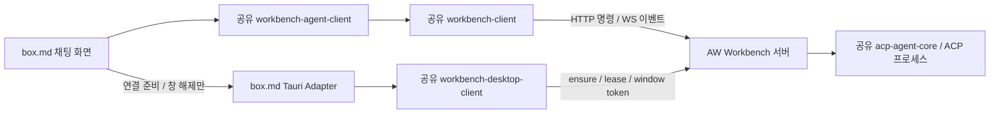

# box.md용 공유 HTTP 에이전트 채팅 모듈 계획

## 결정과 현재 근거

box.md의 ACP 세션·채팅은 AW 독립 Workbench 서버에 HTTP로 명령을 보내고 WebSocket으로 이벤트를 받는다. ACP 프로세스·stdio·권한 중개는 서버가 소유한다. box.md Tauri 백엔드는 서버 연결 준비와 창 자격 증명 관리만 담당한다. 브라우저의 메시지·응답을 Tauri invoke/emit으로 중계하는 ACP 런타임은 작성하지 않는다.

기준 소스는 AW main `52d328b13bbf4bdcf73f9b0541f446e3664eb571`이다. HTTP 화면 전환 브랜치 `043-frontend-http`의 로컬·원격 HEAD는 `1a12f5c56d615f36ed2c1ab3d7de10bda70e1327`이며 push 결과는 Everything up-to-date이다. main에는 이후 독립 서버·Rust 클라이언트 변경도 있다. 원래 브랜치가 squash merge되어 main의 ancestor는 아니므로 소비 코드를 오래된 043 HEAD로 되돌리지 않는다. 미푸시 상태인 `045-process-supervisor`의 변경은 이 연결 작업에 포함하지 않는다.

| 기존 Module | 재사용 범위 | 현재 부족한 Interface |
|---|---|---|
| `packages/workbench-client` | 타입, HTTP call·handshake·토큰 갱신, WS 이벤트·순번·gap 복구 | 채팅 소비자가 작업대·run·이벤트를 함께 소유하는 Interface |
| `crates/workbench-host` | 서버 ensure·신원 확인·소유자 호출 | 데스크톱 연결의 임대·창 토큰·재연결·종료 조립 |
| AW `infrastructure/server_client.rs`의 `ExternalServer` | 위 조립과 실패 복구의 검증된 구현 | 앱 내부 Module이며 Tauri task 실행에 결합됨 |
| `packages/agent-client` | 기존 run DTO·invoke/listen 계약 | 직접 Tauri 호출에 결합되어 HTTP 채팅의 호출 경로로 사용할 수 없음 |
| `crates/acp-agent-core` | 실제 ACP 초기화·세션·프롬프트·권한·프로세스 | 일반 run launcher는 initial goal을 바로 제출함 |
| `crates/workbench-client` | 기존 인스턴스용 Rust 호출·이벤트 기반 | 현재 admission은 run.start 등 실행 operation을 PrerequisiteUnavailable로 거부함. 이 정책을 box.md에서 우회하지 않음 |

코드 근거: `packages/workbench-client/src/index.ts`, `src/connection.ts`, `src/event-client.ts`; AW `src/app/bootstrap-transport.ts`와 `src-tauri/src/infrastructure/server_client.rs`; `crates/acp-agent-core/src/infrastructure/acp/runner.rs`의 `start_session`·`run_prompt_sequence`; `crates/workbench-client/src/application/admission.rs`.

## 목표 흐름

## 1. 데스크톱 연결 Module 추출

새 `crates/workbench-desktop-client`에 AW의 `ExternalServer` 구현을 이동한다. 파일을 복사해 두 소비자가 별도 유지하지 않는다. AW는 기존 경로의 re-export/Adapter로 전환하고 box.md는 같은 Module을 의존한다.

외부 Interface는 `DesktopConnection::new(config)`, `window_connection(identity)`, `retire_window(identity)`, `shutdown()`으로 제한한다. `config`는 데이터 디렉토리·서버 실행 파일·기한이며 `identity`는 창 label·incarnation·신뢰된 origin이다. Tauri 타입·AppHandle을 공개하지 않는다. task 실행과 앱 종료 연결은 Adapter가 담당한다. 기존 복구·임대 갱신·요청 기한·멱등 키·세대 확인·종료 pending 정리를 Module 내부로 이동해 소비자에서 순서를 재구현하지 않게 한다.

소유자 토큰은 Rust에만 보관한다. 화면에는 만료 시각이 있는 창 토큰만 전달하고 로그·localStorage에 자격 증명을 기록하지 않는다. 새 clientId·incarnation으로 기존 AW 창과 소유권을 분리한다. 앱 종료는 자기 창/임대를 해제하며 공유 서버와 다른 클라이언트의 run을 강제 정지하지 않는다.

## 2. 프롬프트 없는 세션 생성 계약

현재 `run.start`는 `AcpRunCommander`에서 initial goal을 바로 제출한다. 빈 문자열을 보내는 방식으로 세션 생성만 수행한 것처럼 처리하지 않는다.

`workbench-protocol`·`workbench-core`·서버에 `run.createSession`을 추가하고 기존 `run.start`의 동작을 유지한다. 공유 ACP launcher에는 초기 프롬프트 제출을 생략하는 명시적 launch intent를 추가한다. 새 operation은 작업대 소유권·시작 장벽·멱등성·취소 정리를 동일하게 적용한다. 준비 중에는 연결 중 상태이며 `SessionCreated` 이후에만 ready로 표시하고 메시지 입력을 허용한다. 실패·기한 초과는 초기화 실패로 표시한다. 실제 모델 프롬프트는 `run.sendPrompt`에서 처음 전송한다.

OpenAPI·Rust/TS 생성 타입·operation kind 표·등록 operation 표·계약 해시는 생성기를 통해 같이 갱신한다. 기존 HTTP 클라이언트의 outcome/epoch 복구 규칙은 변경하지 않는다.

## 3. HTTP 채팅 클라이언트 Module

새 `packages/workbench-agent-client`는 `packages/workbench-client`에 의존한다. ACP framing이나 fetch/WebSocket 재연결을 새로 작성하지 않는다.

작은 Interface: `connect(connectionProvider, workspace)`, `createSession(agentOptions)`, `send(sessionId, text)`, `respondPermission(sessionId, requestId, optionId)`, `closeSession(sessionId)`, `subscribe(listener)`, `dispose()`.

Module이 bench.open과 run 소유권, run 이벤트 구독·replay snapshot·단조 순번·permission 상태·대화 reducer를 함께 관리한다. 명령은 HTTP `run.createSession`·`run.sendPrompt`·`run.respondPermission`·`run.cancel`을 사용하며 이벤트는 WS run stream과 기존 replay operation을 사용한다. 프레임의 실제 반영이 완료된 순번만 cursor로 진전시킨다. 응답을 잃은 command와 세대 변경은 기존 공유 클라이언트의 Applied/NotApplied/Unknown 계약을 그대로 표시하며 메시지를 몰래 다시 보내지 않는다.

인증·권한 오류에서 소유자 토큰이나 기존 Tauri ACP 경로로 fallback하지 않는다. 알려지지 않은 permission option은 선택하지 않는다. 화면 이동은 세션 종료와 구분한다. dispose는 소켓/화면 리소스를 정리하며 run 취소는 명시적 closeSession 동작으로 수행한다.

## 4. 두 소비자 적용과 배포

1. 새 Rust Module을 만들고 AW를 먼저 같은 Interface로 전환한다. 기존 ExternalServer 시험을 새 Module의 Interface 시험으로 옮긴다.
2. run.createSession 계약과 공유 launcher의 idle 시작을 구현한다.
3. 기존 AW HTTP transport를 조립한 공유 TypeScript 채팅 Module을 만들고 box.md `gh-3`에 적용한다. AW worktree/orchestration 화면은 기존 공유 workbench-client를 소비하고 Rust 연결 Adapter를 공유한다. 단순 채팅 facade와 목표·child task·Ralph 반복 상태의 조립 범위는 [공유 채팅 클라이언트](shared-http-agent-client.md)에 기록한다.
4. AW의 이 작업 브랜치 `box-md-http-client`를 작업별 커밋으로 작성·검증·push한다.
5. box.md는 AW Git submodule의 검증된 커밋을 고정하고 pnpm에 공유 HTTP 패키지를 등록한다. Rust는 공유 데스크톱 연결 crate만 소비한다.
6. box.md에는 native 연결 준비/해제 command와 UI Adapter만 둔다. 기존 로컬 문서·댓글·Git 히스토리 저장 경로는 유지한다.
7. CSP의 연결 대상은 검증된 loopback HTTP/WS로 한정한다. native 연결 정보의 주소도 loopback·instance·epoch를 확인한다.

원래 AW checkout의 다른 미추적 문서와 미완료 작업은 이 브랜치에 포함하지 않는다. HTTP 전환 브랜치에 unrelated 045 변경을 섞지 않는다.

## 검증과 완료 증거

- 공유 Rust Interface: 동시 connect, 서버 중단·재기동, 토큰 갱신·임대 재획득, 응답 유실·epoch 변경, 만료된 incarnation 폐기, 제한된 종료 시간, 자기 클라이언트 외 run 보존.
- 실제 서버 + 가짜 ACP 프로세스: createSession이 session/new를 수행하고 사용자 전송 전 session/prompt를 보내지 않음; 이후 두 턴 채팅·스트리밍·권한 선택·취소·EOF를 실제 HTTP/WS로 검증.
- 공유 TS Interface: 유실 응답의 중복 전송 방지, 이벤트 중복·gap·재연결·snapshot 실패 복구, permission 응답의 세션 일치.
- AW와 box.md 화면: 연결·새 세션·메시지·권한·종료; 화면 이동 후 대화 유지; box.md 미저장 문서 보호.
- 실제 설치 에이전트는 빈 임시 작업 디렉토리에서 초기화·세션 생성 handshake를 확인하고, 테스트에 개인 문서나 비밀값을 전달하지 않음.
- 필수 검사: AW 및 box.md의 관련 타입 검사·프런트 테스트/빌드·Rust test/check/fmt. 실제 macOS 화면·서버 프로세스 종료/유지는 직접 증거로 확인한다. 도구가 창에 연결되지 않으면 완료라고 추정하지 않고 검증 제한으로 남긴다.
- 최종 box.md gh-3 커밋과 td 리뷰/완료 기록에는 공유 모듈 버전, 실제 서버 시험 결과, UI 검증 결과를 연결한다.

## 서브 task와 진행 상태

부모는 box.md `gh-3`이다. 모든 서브 task는 해당 GitHub issue의 td task로 등록했다.

| Task | 범위 | 선행 작업 |
|---|---|---|
| gh-21 | 공유 Rust 데스크톱 연결 Module 추출 및 AW 전환 | 없음 |
| gh-22 | run.createSession 및 idle ACP launcher | 없음 |
| gh-23 | 공유 TypeScript HTTP 채팅 클라이언트 | gh-22 |
| gh-24 | box.md HTTP/WS 채팅 적용 | gh-21, gh-23 |
| gh-25 | 실제 통합 검증 및 공유 버전 고정 | gh-24 |

`gh-3`은 기존 `gh-2`와 최종 검증 `gh-25`에 의존한다. gh-21·gh-22는 독립적으로 착수 가능하다. gh-17의 최우측 접기·펴기 패널과 gh-20의 문서 MCP는 별도 feature로 유지한다.

HTTP 브랜치 push 확인과 계획 작성은 완료했다. gh-21에서 `crates/workbench-desktop-client`로 기존 구현과 테스트를 이동하고 AW를 같은 crate의 소비자로 전환했다. 공개 연결 정보는 창 token만 포함하고 owner descriptor는 내부에 둔다. Tauri runtime handle과 종료 상한을 shell에서 주입한다. 기존 22개 회귀 시험과 동기 창 hook·다른 클라이언트 보존의 공개 Interface 시험을 수행한다. 실행 결과 및 사용 계약은 [공유 데스크톱 연결 Module](workbench-desktop-client.md)에 기록한다.

gh-21은 td 리뷰 후 완료했다. gh-22에서 run.createSession과 idle ACP launcher, 생성 계약 및 실제 HTTP/WS 시험을 구현했다. 상세 계약과 검증은 [초기 프롬프트 없는 세션 생성](idle-acp-session-http.md)에 기록한다. gh-23에서 공유 TypeScript 채팅 Module과 공개 Interface·실제 HTTP/WS ACP 시험을 구현했다. 상세 계약은 [공유 채팅 클라이언트](shared-http-agent-client.md)에 기록한다. box.md 연결과 최종 통합 검증은 아직 구현하지 않았다. box.md의 이전 stdio Adapter 초안은 활성 코드에서 제거했고 `gh-3`은 in_progress로 유지한다.
